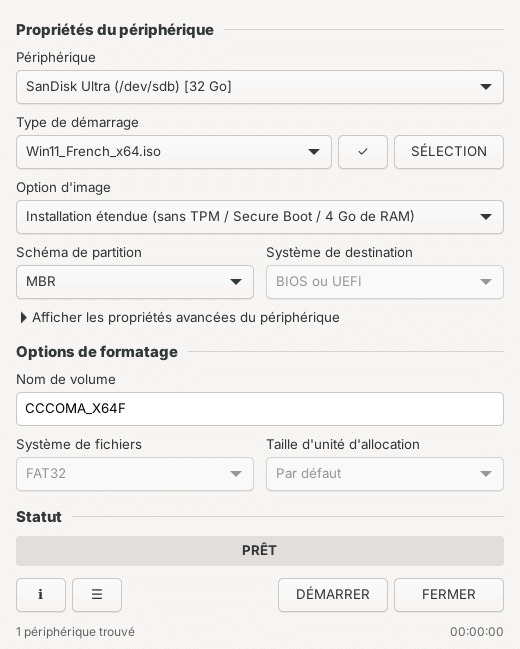

<h1 align="center"><br>LinXfus</h1>
<p align="center"><b>Rufus, version Linux.</b> Clés USB bootables Windows, macOS et Linux, dans la même fenêtre que Rufus.</p>
<p align="center">
  <a href="https://joss943.github.io/Linxfus/">Site</a> ·
  <a href="#installation">Installation</a> ·
  <a href="#utilisation">Utilisation</a> ·
  <a href="#sécurité">Sécurité</a><br><br>
  <a href="https://github.com/Joss943/Linxfus/actions/workflows/ci.yml"></a>
  
  
</p>

<p align="center"></p>

LinXfus reprend la fenêtre de Rufus sous Linux : tu choisis la clé, tu sélectionnes l'image, tu cliques sur **DÉMARRER**. Il reconnaît le type d'image, n'active que les options utiles et ne touche jamais à ton disque système.

## Installation

```bash
curl -fsSL https://raw.githubusercontent.com/Joss943/Linxfus/main/install.sh | sudo bash
```

Ensuite, ouvre **LinXfus** dans tes applications. L'installeur ajoute l'application au menu, son icône, l'autorisation polkit et les dépendances (GTK 4, PyGObject, parted, dosfstools, wimlib, GRUB…) via `dnf`, `apt` ou `pacman`. Il faut GTK 4.10 ou plus récent : Fedora, Ubuntu 24.04, Debian 13, Arch.

Désinstaller : `curl -fsSL https://raw.githubusercontent.com/Joss943/Linxfus/main/install.sh | sudo bash -s -- --uninstall`

## Utilisation

1. **Branche ta clé** : elle apparaît dans « Périphérique ».
2. **SÉLECTION** : choisis ton ISO, IMG ou DMG (ou glisse-le sur la fenêtre). Pour macOS, choisis « Télécharger macOS » dans « Type de démarrage ».
3. **Options** : schéma MBR ou GPT, « Installation étendue » pour Windows 11 sans TPM, nom de volume. Les options qui ne s'appliquent pas sont grisées.
4. **DÉMARRER** : confirme, entre ton mot de passe, attends **PRÊT**. **ANNULER** arrête tout proprement.

Le bouton ✓ calcule le SHA-256 de l'image, ☰ ouvre le journal. Les propriétés avancées permettent d'afficher les disques non amovibles et de vérifier la clé après écriture.

## Ce que ça gère

| | Méthode | Démarre en |
|---|---|---|
| **Windows 7 → 11** | FAT32, `install.wim` > 4 Go découpé (wimlib), GRUB → `bootmgr` pour le BIOS, option sans TPM / Secure Boot / RAM | MBR : BIOS ou UEFI · GPT : UEFI |
| **Linux** et images brutes | écriture directe, `.xz .gz .zst .bz2` décompressés à la volée en multi-cœur, vérification par relecture | celui de l'image |
| **macOS** | recovery officielle téléchargée chez Apple et vérifiée contre la signature Apple ; image disque (Mac Intel) ou OpenCore (Hackintosh) | Mac Intel · OpenCore |

## Sécurité

- **Disque système jamais proposé**, y compris derrière LVM ou LUKS. Disques non amovibles masqués par défaut.
- **Fenêtre sans droits** : seul le moteur d'écriture passe en root, via polkit, au moment de DÉMARRER.
- **Avertissement comme Rufus**, puis re-vérification de l'identité de la clé juste avant d'écrire : une clé échangée entre-temps n'est pas effacée.
- **Rien n'est effacé pour rien** : un DMG illisible est détecté avant d'effacer la clé.
- **Code externe figé** : macrecovery (OpenCorePkg 1.0.8) est vérifié par SHA-256 avant exécution. Les images Apple sont vérifiées par chunklist signée, cache compris.
- **Moteur durci** : `PATH` figé, `umask 077`, montages `nosuid,nodev,noexec`, pas d'`eval`, nettoyage même après annulation ou erreur.
- **Testé à chaque commit** : shellcheck, tests du moteur et de l'interface (pilotée sous Xvfb) sur une clé virtuelle.

## Limites

- **Mac Apple Silicon** : ils ne démarrent pas sur ces clés. Il faut `createinstallmedia` depuis un Mac.
- **macOS sur Mac Intel** : fiable jusqu'à Catalina. Au-delà, si la version est refusée, choisis Hackintosh (OpenCore). La clé n'est pas effacée avant.
- **Windows 11 sans TPM** : méthode LabConfig, comme Rufus. Microsoft peut la casser dans une future version.
- **Pas de persistance** pour les live USB Linux. Pour ça, Ventoy.

## Ligne de commande

Le moteur s'utilise aussi seul, pour les scripts ou un serveur sans écran :

```bash
linxfus -l                                             # clés branchées
sudo linxfus -i Win11.iso -d /dev/sdb --win11-bypass
sudo linxfus -i Fedora.iso -d /dev/sdb --sha256 <hash> -V
sudo linxfus --mac-recovery sonoma -d /dev/sdb
```

`linxfus --help` liste toutes les options.

## Développement

| Fichier | Rôle |
|---|---|
| `linxfus-gui` | interface (Python, GTK 4) |
| `linxfus` | moteur d'écriture (bash) |
| `install.sh` | installeur / désinstalleur |
| `data/` | icône, lanceur, règle polkit |
| `tests/` | tests du moteur (`run.sh`) et de l'interface (`gui_test.py`) |
| `docs/` | site GitHub Pages |

Depuis un clone : `sudo ./install.sh`, ou `./linxfus-gui` pour lancer l'interface sans installer.

## Licence

MIT © Josselin Lerendu
